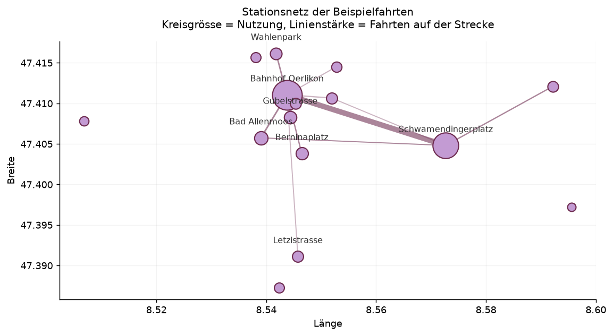
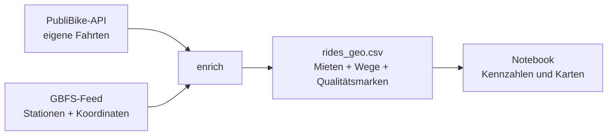
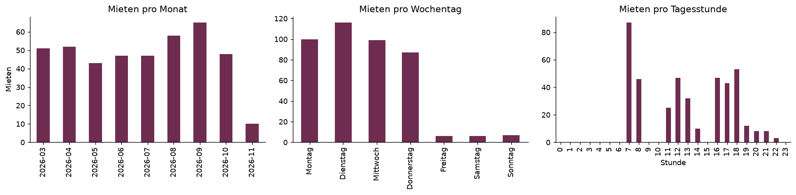
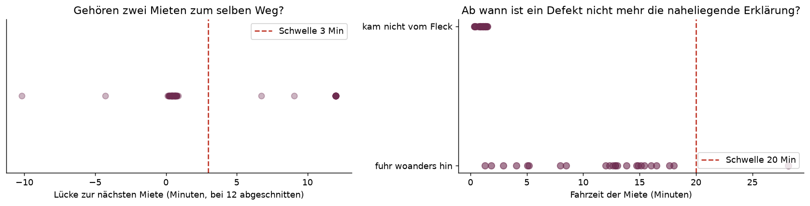

# publibike-rides

[](https://github.com/CristianRavalli/publibike-rides/actions/workflows/tests.yml)
[](LICENSE)

Die eigene Fahrtenhistorie von **PubliBike / Velospot** als CSV herunterladen,
mit Stationskoordinaten anreichern und auf einer Karte auswerten.

Die App zeigt die Fahrten nur einzeln und bietet keinen Export. Dieses Projekt
holt sie über dieselbe Schnittstelle, die die App selbst benutzt, und macht
Zahlen und Karten daraus.



---

## Worum es geht

**Fragestellung.** Wie bewege ich mich mit dem Veloverleih durch die Stadt —
welche Achsen, zu welchen Zeiten, und wie zuverlässig ist das System dabei?
Die letzte Teilfrage war beim Start nicht geplant; sie ergab sich aus den
Daten.

**Datenquelle.** Zwei Quellen, beide live abgerufen:

- die eigene Fahrtenhistorie aus dem Backend von PubliBike/Velospot, nach
  Anmeldung mit Telefonnummer und SMS-Code
- die Stationskoordinaten aus dem offenen GBFS-Feed für Velospot (CC-BY-4.0)

**Vorgehen.**



Die Fahrten werden seitenweise abgerufen und über die Fahrt-ID dedupliziert,
mit den Stationen verbunden — die Zielstation über ihre ID, die Startstation
über den Namen —, um abgeleitete Kennzahlen ergänzt und auf Plausibilität
geprüft.

**Ergebnis.** Zwei Dinge, die in der App nicht sichtbar sind.

Erstens das Bewegungsmuster: eine dominante Pendelachse, ein klarer
Wochenrhythmus mit einem schwachen Tag, Spitzen am Morgen und am späten
Nachmittag.



Zweitens — und das war die Überraschung — dass sich **abgebrochene Mieten in
den Daten finden lassen**, obwohl die API kein solches Feld kennt. Wer ein
Velo nimmt, das nicht läuft, und sofort das nächste nimmt, hinterlässt zwei
Mieten dicht hintereinander. 43 von 258 Mieten sehen so aus, ein Sechstel.

Ob daraus ein Defekt wird, ist allerdings die zweite Frage, und sie fällt
knapper aus als gedacht. Bei 19 dieser Abbrüche kam als Ersatz ein Velo eines
anderen Typs — meist ein E-Bike nach einem Normalvelo. Ein Defekt erklärt
das, ein Umstieg aufs bessere Fahrzeug aber genauso gut, und die Daten
entscheiden es nicht. Belastbar sind die **24 Fälle mit gleichem Typ**: Ein
E-Bike gegen ein E-Bike zu tauschen ergibt nur Sinn, wenn das erste nicht
fuhr.

Beide Schwellen liegen in einer Lücke der Verteilung, nicht im Gedränge — sie
lassen sich verschieben, ohne dass sich das Ergebnis ändert. Das ist der
Grund, warum die Regel trägt:



Die Bilder stammen aus dem synthetischen Beispieldatensatz, nicht aus echten
Fahrten — siehe unten.

---

## Entstehung

Ausgangspunkt war ein Konsolen-Snippet, mit dem ich den Endpunkt der App
gefunden hatte — Adresse, Header und Pagination standen damit fest, die
Fahrten liessen sich schon herausholen. Daraus wurde in mehreren Runden dieses
Werkzeug: die Implementierung entstand mit **Claude**, die Fachentscheide und
die Datenlogik kommen von mir. Die Commits weisen das mit `Co-Authored-By`
aus.

Die Regel, die das Projekt über einen blossen Export hinaushebt, geht auf
einen Irrtum zurück. Die erste Fassung der Abbruch-Erkennung hielt nur jene
Mieten für Ausfälle, bei denen das Velo gar nicht vom Fleck kam, und sortierte
32 weitere als harmlose Anschlussfahrten weg. Das war falsch: Ein Velo kann
auch unterwegs ausfallen — man stellt es ab, wo man gerade ist, und nimmt das
nächste, um ans Ziel zu kommen. Dass die Miete ein Stück weit führte, sagt
nicht, dass sie erfolgreich war, sondern nur, wann der Defekt auffiel.

Dieser Unterschied steht in keinen Daten. Er kam aus der Erfahrung, das
System täglich zu benutzen, und erst danach liess er sich in den Zahlen
nachweisen — die Fahrzeiten der betroffenen Mieten springen von 14.9 auf 26.1
Minuten, mit nichts dazwischen. So entstand die 20-Minuten-Grenze, oberhalb
derer ein Defekt nicht mehr die naheliegende Erklärung ist.

Dieselbe Ehrlichkeit verlangt den Nachsatz: Oberhalb der Grenze steht ein
einziger Datenpunkt. Die Markierung heisst deshalb `neumiete_nach_langer_fahrt`
und benennt das Beobachtete, nicht ein vermutetes Motiv.

Und dann kam die Korrektur der Korrektur. Beim Versuch, aus den gefundenen
Ausfällen eine Zuverlässigkeitskennzahl zu bauen, fiel auf, dass Normalvelos
in 74 % der Fälle abgebrochen werden und E-Bikes nur in 11 %. Ein scheinbar
harter Befund — bis die Frage kam, was danach genommen wurde. Fast immer ein
E-Bike. Der Unterschied misst also womöglich nicht die Wartung der
Normalvelos, sondern die Vorliebe des Fahrers.

Darum heissen die Markierungen heute `abbruch_*` statt `defekt_*`, und darum
gibt es die Spalte `ersetzt_durch`. Die Reihenfolge ist dabei der eigentliche
Inhalt: erst eine Regel, die zu wenig fand, dann eine, die zu viel behauptete,
und am Ende eine, die sagt, was sie sieht. Hätte ich gleich ein Dashboard
gebaut, stünde dort jetzt «74 % der Normalvelos defekt» — überzeugend
aussehend und nicht haltbar.

---

## Zum Ausprobieren ohne eigenes Konto

Im Repository liegt unter `data/beispiel/` ein **erfundener** Datensatz: 421
Mieten über acht Monate. Die Stationen und ihre Koordinaten sind echt, die
Fahrten nicht. Das Notebook greift automatisch darauf zurück, wenn keine
eigenen Daten da sind, und sagt in der ersten Zelle, welche Quelle es benutzt.

```bash
git clone https://github.com/CristianRavalli/publibike-rides.git
cd publibike-rides
python3 -m venv .venv && source .venv/bin/activate
pip install -r requirements.txt
jupyter notebook notebooks/01_analyse.ipynb
```

Neu erzeugen lässt er sich mit `python3 scripts/beispieldaten.py`, die Bilder
mit `python3 scripts/bilder.py`. Der Zufallsstartwert ist fest, der Lauf also
reproduzierbar. Eingebaut sind bewusst alle Muster, die die Pipeline erkennen
soll — wer die Regeln prüfen will, hat damit einen Datensatz, bei dem die
richtige Antwort bekannt ist.

---

## Eigene Fahrten herunterladen

Du brauchst Python 3.9 oder neuer, sonst nichts: Der Download nutzt
ausschliesslich die Standardbibliothek. Die Pakete aus `requirements.txt`
braucht erst die Analyse.

```bash
python3 -m publibike_rides
```

Der Befehl fragt nach deiner Telefonnummer, schickt dir eine SMS und fragt den
Code ab. Beide Eingaben laufen **ohne Echo** — du siehst beim Tippen nichts.
Das ist Absicht: sonst stehen Telefonnummer und Code im Verlauf des Terminals
und landen in Screenshots, Logs oder geteilten Sitzungen.

Danach liegen vier Dateien bereit:

| Datei | Eine Zeile ist | Schlüssel |
|---|---|---|
| `data/rides.csv` | eine Miete, wie die API sie liefert | `id` |
| `data/rides_raw.json` | dasselbe als JSON, mit allen Feldern | `id` |
| `data/stations.csv` | eine Station mit Koordinaten | `station_id` |
| `data/rides_geo.csv` | eine Miete, angereichert und geprüft | `ride_id`, dazu `journey_id` für den Weg |

Für die Analyse reicht `data/rides_geo.csv` — die Datei lässt sich auch direkt
in Excel, Power BI oder R öffnen.

Achtung bei der Zähleinheit: Eine Zeile ist eine **Miete**, nicht eine Fahrt.
Mehrere Mieten können zu einem **Weg** gehören, erkennbar an derselben
`journey_id`. Warum, steht unter [Zur Datenqualität](#zur-datenqualität).

**Laufrhythmus und Nachholen.** Es gibt keinen Zeitplan; der Abruf läuft, wenn
du ihn startest. Jeder Lauf holt die vollständige Historie neu und schreibt
die Dateien neu — zweimal ausgeführt entsteht zweimal dasselbe Ergebnis. Ein
verpasster Lauf muss deshalb nicht nachgeholt werden, und ein Backfill-Konzept
braucht es nicht.

**Was sich planen lässt und was nicht.** Drei Dinge, in dieser Reihenfolge:

*Ein Lauf mit gültigem Token braucht niemanden.* `download`, `stations` und
`enrich` laufen ohne Eingabe durch. Das ist der Normalfall, und dafür genügt
ein Eintrag in `launchd` oder `cron` auf dem eigenen Rechner.

*Die Erneuerung des Tokens braucht einen Menschen mit Telefon.* Läuft er ab,
endet der Abruf mit `HTTP 401`, und `login` verlangt eine neue SMS. Das lässt
sich nicht wegprogrammieren, solange die SMS an ein Telefon geht — **in einer
GitHub Action oder sonst in der Cloud ist der Abruf deshalb nicht möglich.**

*Diese Erneuerung fällt selten an.* Ein Token vom 18. November 2026 war am
22. November noch gültig, hielt also mindestens vier Tage. Wie lange genau,
ist nicht gemessen — die Zahl ist eine Untergrenze und keine Zusage.

Ein geplanter Lauf auf dem eigenen Rechner ist damit praktikabel: Er läuft
meist durch, und wenn nicht, meldet er sich mit einem `401`. Wie weit sich
das treiben lässt, steht in
[Issue #7](https://github.com/CristianRavalli/publibike-rides/issues/7).

### Einzelne Schritte

```bash
python3 -m publibike_rides login      # anmelden
python3 -m publibike_rides download   # Fahrten holen
python3 -m publibike_rides stations   # Stationen holen
python3 -m publibike_rides enrich     # beides verbinden
```

Der Token wird in `.credentials.json` abgelegt (nur für dich lesbar) und gilt,
bis die App ihn verfallen lässt. Danach einfach `login` wiederholen.

Sobald `data/rides_geo.csv` da ist, nimmt das Notebook deine Fahrten statt des
Beispieldatensatzes — derselbe Aufruf wie oben, kein Umschalten nötig.

---

## Was im Notebook steht

- Überblick: Mieten, Wege, Stunden, aktive Tage, genutzte Stationen
- Datenqualität zuerst: welche Mieten markiert sind und warum
- die Gegenprobe, dass beide Schwellen der Regel in einer Lücke liegen
- Muster nach Monat, Wochentag und Tagesstunde
- Verteilung der Fahrtdauer, E-Bike gegen Velo
- die meistgenutzten Stationen und Strecken
- Mieten gegen Wege: wie oft aus zwei Mieten eine Fahrt wird
- eine Karte mit Stationen (Grösse nach Nutzung) und Verbindungslinien
- eine Wärmekarte

Die Karten landen als HTML in `maps/`, die Bilder fürs README in `docs/`.

---

## Wie es funktioniert

Die App unter `web.publibike.ch` ist eine Flutter-Anwendung, die mit einem
Backend auf `velospot.info` spricht. Drei Aufrufe genügen:

| Schritt | Aufruf | Antwort |
|---|---|---|
| 1 | `POST /pbvsng/loginProcess` mit `{phoneNumber}` | `loginToken` |
| 2 | `POST /pbvsng/verifyOtpCode` mit `{otpCode, loginToken}` | `authenticationToken` |
| 3 | `GET /pbvsng/getUserRideHistory` mit Header `AuthenticationToken` | die Fahrten, seitenweise |

Jeder Aufruf braucht zusätzlich den Header `ApiAuthenticationKey`. Das ist ein
statischer Schlüssel, der die App identifiziert, nicht dich. Er steht im
öffentlich ausgelieferten JavaScript der App; `publibike_rides` liest ihn zur
Laufzeit von dort, damit er nicht im Repository liegen muss. Wer ihn lieber
selbst setzt, nutzt die Umgebungsvariable `PUBLIBIKE_API_KEY`.

### Stationskoordinaten

Die Fahrtenhistorie nennt Stationsnamen und für die Zielstation eine ID, aber
keine Koordinaten. Die kommen aus dem offenen **GBFS**-Feed für Velospot, den
MobiData BW bereitstellt (Lizenz CC-BY-4.0):

```
https://api.mobidata-bw.de/sharing/gbfs/v3/velospot_ch/station_information
```

Der Join läuft zweigleisig: die Zielstation über die ID (`endStationId` 1148
entspricht `PIB:Station:1148`), die Startstation über den Namen, weil die
Historie dafür keine ID liefert. Über meine eigenen 258 Fahrten an 56
verschiedenen Stationen wurden alle zugeordnet.

Der eigene GBFS-Feed von PubliBike (`api.publibike.ch/v1/gbfs/...`) antwortet
Stand November 2026 mit einer leeren Stationsliste — vermutlich wegen der
Migration auf das neue Backend. Deshalb der Umweg.

---

## Zur Datenqualität

Ein paar Dinge, die beim Auswerten wichtig sind. Die Zahlen in diesem
Abschnitt stammen aus **meinen eigenen 258 Fahrten**, nicht aus dem
Beispieldatensatz — sie sind der Grund, warum die Regeln so aussehen, wie sie
aussehen.

**Die Distanz ist Luftlinie.** Die API liefert keine GPS-Spur, nur Start- und
Zielstation. `distance_km_luftlinie` ist die gerade Verbindung zwischen beiden
Punkten — die gefahrene Strecke ist länger. Alle darauf aufbauenden Spalten
heissen deshalb ausdrücklich `luftlinie`.

**Die Dauer der API ist aufgerundet.** `durationInMinute` ist immer die auf
ganze Minuten aufgerundete Fahrzeit — über alle 258 Fahrten lag die Abweichung
zur Zeitstempel-Rechnung in jedem einzelnen Fall bei exakt 0 oder 1 Minute,
nie mehr. Eine Fahrt von 19 Sekunden steht dort als `1`.
Gerechnet wird deshalb mit `duration_seconds` aus `endDate` minus `startDate`;
das API-Feld bleibt als `duration_min` daneben stehen.

**Manche Fahrten sind physisch unmöglich.** Eine Miete über 16 Sekunden, die an
einer anderen Station endet als sie begann, ist keine Fahrt, sondern ein
Buchungsartefakt. Solche Zeilen bekommen `quality_flag = tempo_unplausibel`
(Schwelle: 40 km/h Luftlinie) und sollten aus Tempo-Auswertungen fliegen.

**Eine Fahrt zerfällt oft in zwei Mieten.** Beginnt eine Miete innerhalb von
drei Minuten nach der vorherigen — auch überlappend —, war es in Wahrheit ein
Weg. Dafür gibt es drei Gründe, und die Daten erlauben, sie auseinanderzuhalten:

| Markierung | Was beobachtet wurde | Erkennungsmerkmal |
|---|---|---|
| `abbruch_sofort` | Die Miete endete, wo sie begann — das Velo kam nicht vom Fleck. | Start- und Zielstation gleich, höchstens 20 Minuten. |
| `abbruch_unterwegs` | Die Miete endete woanders und wurde trotzdem sofort abgelöst. | Andere Zielstation, höchstens 20 Minuten. |
| `neumiete_nach_langer_fahrt` | Lange Miete, trotzdem sofort abgelöst. Ein Defekt ist hier nicht die naheliegende Erklärung. | Länger als 20 Minuten. |

Keine dieser Markierungen nennt eine Ursache, und das ist Absicht — siehe
unten.

Beide Schwellen sind unempfindlich, und das spricht für die Regel. Zwischen 60
und 234 Sekunden kommt keine einzige Lücke vor, also liefern 1, 2 und 3
Minuten dasselbe. Und die Fahrzeiten springen von 896 Sekunden direkt auf
1565, also liefert jede Grenze zwischen 15 und 26 Minuten dasselbe. Von 258
Mieten entfielen 11 auf `abbruch_sofort`, 32 auf `abbruch_unterwegs` und eine
auf `neumiete_nach_langer_fahrt`.

**Ein Abbruch ist noch kein Defekt.** Das ist die wichtigste Einschränkung
dieses Projekts, und sie kam erst beim Nachrechnen heraus. Auffällig war
zunächst dies:

| | Abbrüche | Quote | Konfidenzintervall |
|---|---|---|---|
| E-Bike | 26 von 235 | 11.1 % | 7.7–15.7 % |
| Normalvelo | 17 von 23 | 73.9 % | 53.5–87.5 % |

Drei von vier Normalvelos werden abgebrochen, und die Intervalle berühren
sich nicht einmal. Das sieht nach einem harten Befund über die Normalvelos
aus — bis man nachsieht, was danach genommen wurde: in **16 von 17** Fällen
ein E-Bike.

Damit ist die Sache nicht mehr entscheidbar. Ein defektes Normalvelo und ein
Umstieg aufs E-Bike sehen in den Daten identisch aus: kurze Miete, sofort die
nächste. Die Spalte `ersetzt_durch` hält deshalb fest, welcher Typ folgte.
Wird ein Velo durch **denselben** Typ ersetzt, erklärt ein Umstieg nichts und
der Defekt bleibt die plausibelste Lesart. Über alle 43 Abbrüche:

- **24 mit gleichem Typ**, davon 23 mal E-Bike gegen E-Bike — belastbar.
- **19 mit Typwechsel** — Defekt oder Umstieg, nicht zu trennen.

Deshalb heissen die Markierungen `abbruch_*` und nicht `defekt_*`. Eine
frühere Fassung tat Letzteres und behauptete damit über 43 Mieten etwas, das
für 19 davon nicht belegt ist.

**Eine Aussage über einzelne Stationen tragen die Daten nicht.** 51 Stationen,
im Median zwei Ausgaben je Station; nur zehn kommen auf fünf oder mehr.
Hardplatz steht mit 33 % Abbrüchen schlecht da, Wydäckerring mit 7 % gut —
die Konfidenzintervalle lauten 19–51 % und 2–22 % und überlappen deutlich.
Eine Stationsrangliste wäre eingefärbtes Rauschen.

Bei der letzten Markierung ist Vorsicht angebracht, und sie steht hier als
Beispiel dafür, wie weit eine Regel tragen darf. Die 20-Minuten-Grenze liegt
zwar in einer breiten Lücke — aber oberhalb davon steht **ein einziger
Datenpunkt**. Dass ein Velo nach 26 Minuten ausfällt, ist nicht unmöglich; es
ist nur weniger wahrscheinlich als nach zwei. Deshalb benennt die Markierung,
was beobachtet wurde, und nicht, warum. Ein naheliegender Grund wäre, die
freien 30 Minuten vor Ablauf zurückzusetzen — belegen lässt sich das mit einem
Fall nicht, und ein Spaltenwert, der eine Absicht behauptet, wandert sonst
ungeprüft in die Auswertung des Nächsten.

**Die Zähleinheit ist der Weg, nicht die Miete.** Zusammenhängende Mieten
bekommen dieselbe `journey_id`, dazu `journey_leg` und `journey_legs`. Aus 258
Mieten wurden so 214 Wege; die längste Kette umfasst vier Mieten. Wer «wie oft
bin ich gefahren» beantworten will, zählt Wege — wer wissen will, wie oft ein
Velo ausfiel, zählt Mieten.

Die Spalte `gap_to_next_min` steht in jeder Zeile und macht beides nachprüfbar.

**Rundfahrten haben Distanz 0.** Start gleich Ziel heisst nicht, dass nichts
gefahren wurde — die Strecke dazwischen ist nur nicht rekonstruierbar. Die
Spalte `is_round_trip` macht sie auffindbar.

**Die Historie hat einen Anfang.** Die API lieferte im Test nur Fahrten ab
Februar 2026 zurück. Ob ältere Fahrten existieren und nicht ausgeliefert
werden, lässt sich von aussen nicht feststellen.

---

## Tests

```bash
python3 -m unittest discover tests
```

23 Tests, ohne Netz und ohne Zugangsdaten. Geprüft werden die Distanzrechnung,
der Join über ID und Name, die Abgrenzung der drei Gründe für eine vorzeitig
beendete Miete und die Verkettung zu Wegen. Der Schwerpunkt liegt auf den
Fällen, die *nicht* markiert werden sollen — eine lange Rundfahrt, eine grosse
Lücke, eine Fahrt über 20 Minuten. Eine Regel, die zu viel einsammelt, fällt
sonst nicht auf.

In der CI laufen sie bei jedem Push auf Python 3.9, 3.11 und 3.13 — das
README verspricht 3.9 oder neuer, und ein Versprechen, das nicht geprüft wird,
ist eine Behauptung. Bewusst ohne `pip install`: Pipeline und Tests kommen
ohne fremde Pakete aus, und schleicht sich eine Abhängigkeit ein, schlägt der
Lauf fehl.

Der 3.9-Job läuft auf einem älteren Ubuntu-Abbild, weil 3.9 seit Oktober 2025
End-of-Life ist und auf dem aktuellen nicht mehr angeboten wird. In der Matrix
bleibt es, weil macOS es als System-Python ausliefert: Wer dort `python3`
eintippt, bekommt 3.9 — und genau darauf beruht die Zusage, dass der Download
ohne Installation läuft.

Dazu eine zweite Prüfung:

```bash
python3 scripts/pruefe_notebooks.py
```

Sie schlägt an, wenn ein Notebook mit Ausgaben eingecheckt wurde. Ausgaben
enthalten die Daten, auf denen das Notebook lief — Tabellen, Stationsnamen,
ganze Karten als eingebettetes HTML. Ohne diese Prüfung wäre die Regel weiter
unten nur ein guter Vorsatz.

---

## Was nicht ins Repository gehört

`.gitignore` hält Folgendes draussen, und das ist Absicht:

- `data/` — deine Fahrten sind Bewegungsdaten. Wo du wann warst, über Monate.
  Ausgenommen ist `data/beispiel/`: erfundene Fahrten, die niemandem gehören.
- `.credentials.json` — dein Zugangstoken.
- `maps/` und ausgeführte Notebooks — sie enthalten dieselben Daten noch einmal.

Auch der Beispieldatensatz hält sich daran: Keine seiner zwölf Stationen kommt
in meinen tatsächlichen Fahrten vor. Ein Beispiel, das die eigene Pendelachse
nachzeichnet, gäbe genau das preis, was hier geschützt werden soll — auch wenn
«erfunden» darüber steht.

Das Notebook wird **ohne Ausgaben** eingecheckt. Wenn du es ausgeführt hast und
committen willst, vorher leeren:

```bash
jupyter nbconvert --clear-output --inplace notebooks/01_analyse.ipynb
```

---

## Rechtliches und Fairness

Die Schnittstelle ist nicht dokumentiert und nicht für Dritte freigegeben. Sie
kann sich jederzeit ändern oder wegfallen; dann hört dieses Werkzeug auf zu
funktionieren.

Abgerufen werden ausschliesslich die eigenen Fahrten, mit der eigenen
Anmeldung — dieselben Daten, die die App ohnehin anzeigt. Zwischen den Seiten
liegt eine kurze Pause, damit der Abruf das Backend nicht belastet. Das
Werkzeug taugt nicht dazu, an fremde Daten zu kommen, und soll das auch nicht.

Die Stationsdaten stammen aus einem offenen Feed unter CC-BY-4.0.

**Lizenz.** Der Code steht unter der MIT-Lizenz, siehe [LICENSE](LICENSE) —
benutzen, ändern und weitergeben ist ausdrücklich erlaubt, Gewährleistung gibt
es keine. Das betrifft nur den Code: Die Fahrtdaten gehören der Person, die
sie abruft, und liegen ohnehin nie im Repository.

---

## Projektstruktur

```
publibike_rides/
  api.py              Login und Fahrtenabruf (nur Standardbibliothek)
  stations.py         GBFS-Feed holen und normalisieren
  enrich.py           Join, Wege, abgeleitete Kennzahlen, Qualitätsmarken
  cli.py              Kommandozeile
scripts/
  beispieldaten.py    erfundenen Datensatz erzeugen
  bilder.py           Karte und Grafiken fürs README rendern
notebooks/
  01_analyse.ipynb    Kennzahlen, Gegenproben, Karten
tests/
  test_pipeline.py    23 Tests für Distanz, Join, Regeln, Verkettung
docs/                 die Bilder aus diesem README
data/beispiel/        erfundener Datensatz, eingecheckt
data/                 eigene Fahrten, wird erzeugt und nicht eingecheckt
maps/                 Karten aus dem Notebook, wird erzeugt
```
